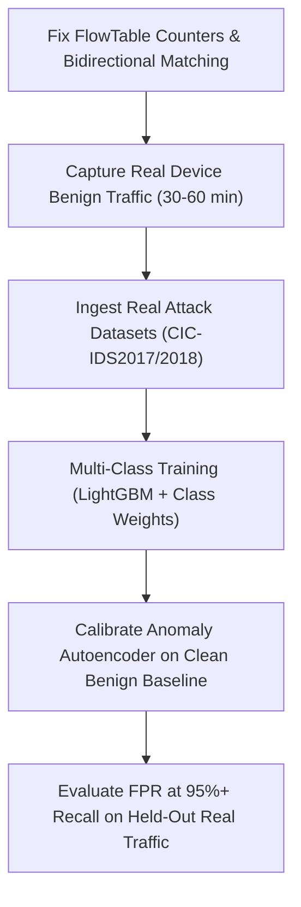

# Sentinel Edge — Comprehensive Analysis, Issue Audit & Remediation Plan

This document details the architectural scan of **Sentinel Edge** against the [Local Adaptive Firewall Project Proposal.md](file:///d:/Sentinel%20Edge/Local%20Adaptive%20Firewall%20Project%20Proposal.md), itemizes all discovered issues, provides a deep-dive on the Machine Learning model and training data, and outlines a step-by-step plan to make the project fully runnable, accurate, and production-ready.

---

## 1. Executive Summary & Audit Overview

Sentinel Edge is designed as an on-device, lightweight adaptive firewall that combines:
1. **Safety Contract** (Always allow loopback, DHCP, DNS; fail-open default).
2. **Reputation Filtering** (Bloom filter accelerator + exact/CIDR lookups).
3. **Signatures & Protocol Sanity** (Aho-Corasick multi-pattern payload matching + header checks).
4. **Connection Behaviour** (Port scan, SYN flood, brute-force detectors).
5. **Flow-Based ML Classifier** (LightGBM on flow statistics).
6. **Novelty Autoencoder** (Unsupervised benign baseline reconstruction).
7. **Local UI & Storage** (FastAPI dashboard, SQLite evidence log, OS toast notifications with "Allow once").

### Audit Verdict
While the broad architecture cleanly reflects the proposal's 8 MVP + 6 stretch goals, **critical implementation flaws currently break the ML model training data (99.7% empty flows), trigger false-positive blocks on normal web browsing (video streaming flagged as SYN flood), crash the feedback retraining loop (`ImportError`), and break the web dashboard styling (404 on CSS)**.

---

## 2. Comprehensive Inventory of Issues

### A. Machine Learning & Feature Extraction Flaws

| # | Component | Location | Issue Description | Severity |
|---|-----------|----------|-------------------|----------|
| **1** | **Flow Table** | [`sentinel/flows/flow_table.py`](file:///d:/Sentinel%20Edge/sentinel/flows/flow_table.py#L137-L144) | **Zero-Packet Flow Bug:** When a new flow arrives, `FlowRow(pkt)` is initialized with 0 counts, but `row.update(pkt)` is **never called** for that first packet. All 1-packet flows (scans, floods, synthetic rows) end up with `total_pkt_count=0.0`, `fwd_bytes=0.0`, `syn_count=0.0`, and `init_win_bytes_fwd=0.0`. In `data/flows/flows.csv`, **794 of 796 rows had 0 packets**. | **Critical** |
| **2** | **Flow Keying** | [`sentinel/flows/flow_table.py`](file:///d:/Sentinel%20Edge/sentinel/flows/flow_table.py#L137) | **Unidirectional Keying:** `FlowTable.update` only searches for the exact 5-tuple `(proto, src, sport, dst, dport)`. Reverse response packets `(proto, dst, dport, src, sport)` are treated as a separate forward flow. Consequently, `bwd_pkts`, `bwd_bytes`, and all backward statistics are never computed. | **High** |
| **3** | **Train/Serve Skew** | [`sentinel/pipeline/flow_ml.py`](file:///d:/Sentinel%20Edge/sentinel/pipeline/flow_ml.py#L121) | **Inference Gate Disconnect:** Runtime `FlowMLStage` requires `total_pkts >= 6` before running inference. But the training dataset was composed almost entirely of flows with `total_pkt_count == 0`. | **High** |
| **4** | **Label Scope** | [`sentinel/ml/train.py`](file:///d:/Sentinel%20Edge/sentinel/ml/train.py#L40) | **Missing Multi-Class Support:** The proposal mandates: *"Start binary, then add classes: scan, flood, brute force, injection, beaconing."* `train.py` strictly forces binary labels (`y = (y_text != 'benign').astype(int)`), preventing the system from identifying the specific attack class. | **Medium** |
| **5** | **Session Split** | [`sentinel/ml/train.py`](file:///d:/Sentinel%20Edge/sentinel/ml/train.py#L46-L57) | **Evaluation Collapse on Small Sets:** In the synthetic dataset with 7 pcaps, holding out 25% of sessions isolates only 1 capture (`web_injection.pcap`), containing 4 attack rows and 0 benign rows. This yields degenerate test metrics (`precision=0.0, recall=0.0, fpr=0.0`). | **Medium** |
| **6** | **Autoencoder** | [`sentinel/ml/autoencoder.py`](file:///d:/Sentinel%20Edge/sentinel/ml/autoencoder.py#L225-L229) | **Multi-CSV Crash:** `np.stack(..., axis=0)` on a list of dataframes of varying lengths raises `ValueError: all input arrays must have the same shape`. Must use `np.vstack` / `np.concatenate`. Also lacks `np.nan_to_num` handling for corrupted entries. | **High** |
| **7** | **Feedback Loop** | [`sentinel/feedback/loop.py`](file:///d:/Sentinel%20Edge/sentinel/feedback/loop.py#L59) | **ImportError on Retraining:** Imports `run_training_from_csvs` from `sentinel.ml.train`, but that function does not exist. Any call to `/api/feedback/retrain` crashes immediately. | **High** |

---

### B. Detection Pipeline & False-Positive Vulnerabilities

| # | Component | Location | Issue Description | Severity |
|---|-----------|----------|-------------------|----------|
| **8** | **SYN Flood Detector** | [`sentinel/pipeline/behaviour.py`](file:///d:/Sentinel%20Edge/sentinel/pipeline/behaviour.py#L87-L90) | **Legitimate Downloads Blocked:** `if pkt.proto == PROTO_TCP and pkt.tcp is not None:` adds **every** TCP packet (ACKs, data payloads, FINs) to `_syn_ring`. Any fast download or video stream (>80 pkts/s) triggers a SYN flood alert and **blocks the legitimate server**. Must check `pkt.tcp.syn and not pkt.tcp.ack`. | **Critical** |
| **9** | **Rate Calculation** | [`sentinel/pipeline/behaviour.py`](file:///d:/Sentinel%20Edge/sentinel/pipeline/behaviour.py#L101-L104) | **2-Packet False Positive Spike:** If two packets arrive within 1ms, `span = 0.001s`, producing an instantaneous calculated rate of `2000 > 80`, triggering a false block. A minimum packet count (e.g. `len(ring) >= 15` and `span >= 0.25s`) is required. | **High** |
| **10** | **Fragment Tracker** | [`sentinel/pipeline/protocol.py`](file:///d:/Sentinel%20Edge/sentinel/pipeline/protocol.py#L45, L114-L116) | **Fragment Byte Count Bug:** The table stores accumulated **bytes**, but line 115 checks `if count > 64: drop("fragment flood")`. Any standard IP packet >64 bytes is dropped on its second fragment. | **High** |
| **11** | **ECN Violation** | [`sentinel/pipeline/protocol.py`](file:///d:/Sentinel%20Edge/sentinel/pipeline/protocol.py#L85-L88) | **Standard ECN SYN Packets Dropped:** Drops TCP SYN packets if ECE or CWR flags are set (`drop_syn_cwe: True`). RFC 3168 defines standard ECN setup via `SYN + ECE + CWR`, used by Windows, macOS, Linux, and iOS browsers. | **Medium** |
| **12** | **DNS Responses** | [`sentinel/packets.py`](file:///d:/Sentinel%20Edge/sentinel/packets.py#L287) | **Upstream DNS Ignored:** `parse_ip` only decodes DNS queries when `pkt.udp.dport == 53`. Inbound DNS responses arrive from `sport == 53`, leaving `pkt.dns = None` and bypassing domain reputation checks. | **Medium** |

---

### C. Architecture, UI & Tooling Issues

| # | Component | Location | Issue Description | Severity |
|---|-----------|----------|-------------------|----------|
| **13** | **Service Lifecycle** | [`sentinel/service.py`](file:///d:/Sentinel%20Edge/sentinel/service.py#L83) | **State Loss on `load_model`:** `svc.load_model()` re-instantiates `self.engine = DecisionEngine(...)`, which wipes active `allow_once` entries, runtime blocklists, and subscriptions. Needs `engine.set_ml_model()`. | **Medium** |
| **14** | **Web Dashboard** | [`sentinel/ui/server.py`](file:///d:/Sentinel%20Edge/sentinel/ui/server.py#L26, L127) | **Missing Static Mount (404 on CSS):** `StaticFiles` is imported but never mounted via `app.mount("/static", ...)`. Navigating to `http://127.0.0.1:8636` yields a 404 for `/static/style.css`, rendering the dashboard unstyled. | **High** |
| **15** | **Windows Shutdown** | [`sentinel/service.py`](file:///d:/Sentinel%20Edge/sentinel/service.py#L155) | **SQLite File Locking:** `stop()` does not close `event_log`, `intel_cache`, or `feedback` SQLite database handles, causing `WinError 32` during automated testing or cleanup. | **Medium** |
| **16** | **Reputation Feeds** | [`tools/update_blocklists.py`](file:///d:/Sentinel%20Edge/tools/update_blocklists.py#L35) | **URLhaus HTTP 410 Gone:** `urlhaus.abuse.ch/downloads/text_recent/` returns 410 Gone (abuse.ch retired anonymous bulk downloads). Zero domains are stored in `reputation.bin`. Must switch to an active mirror or authenticated endpoint. | **Medium** |

---

## 3. Deep Dive: Machine Learning & Training Data

### Current Training Workflow
```
[harness/runner.py --mode build]
       │
       ▼ (7 synthetic pcaps: scan, flood, brute, web, malformed, benign)
[tools/pcap_to_flows.py]
       │
       ▼ (reads FlowTable -> data/flows/flows.csv)
[sentinel/ml/train.py & train_anomaly.py]
       │
       ▼
[data/models/flow_lgbm.joblib & flow_ae.npz]
```

### Root Cause of Poor ML Generalization
1. **The 0-Packet Artifact:** Because `FlowTable.update` failed to record the first packet upon flow creation, 794 of the 796 synthetic flows were logged with `fwd_pkt_count = 0`, `total_pkt_count = 0`, and `syn_count = 0`. The LightGBM model was effectively trained on empty artifacts.
2. **Lack of Flow Dynamics:** Synthetic pcaps generated by Scapy only send isolated SYN packets without full TCP handshakes, payloads, or real round-trip timing. Genuine flow metrics (Inter-Arrival Time distributions, forward/backward packet size ratios, active/idle periods) are completely flat or missing.
3. **Severe Class Imbalance:** The harness provides only 159 benign flows against 637 attack flows. In real network environments, benign traffic accounts for 99.9%+ of all flows.

### Roadmap to High Accuracy & Correctness



1. **Fix Flow Extraction:**
   - In `FlowTable.update`, immediately call `row.update(pkt)` on new flows.
   - Aggregate both directions of a conversation by matching `rev_key = (proto, dst, dport, src, sport)`.

2. **Ingest Real Public Benchmark Datasets (CIC-IDS2017 / CIC-IDS2018 / UNSW-NB15):**
   - Public datasets contain millions of real flows recorded across multiple days with realistic background noise.
   - Use [`sentinel/ml/datasets.py`](file:///d:/Sentinel%20Edge/sentinel/ml/datasets.py) which already maps CICFlowMeter columns to the `FEATURES` contract.
   - Example command:
     ```powershell
     python -m sentinel.main train --cic --csv "C:\data\cic\Wednesday-workingHours.pcap_ISCX.csv" --out data\models\flow_lgbm.joblib
     ```

3. **Capture Real Local Benign Traffic:**
   - Add a lightweight capture script (`tools/capture_benign.py`) that captures 30–60 minutes of real user activities (web browsing, streaming, package downloads, Slack/Discord).
   - Replay this capture through `pcap_to_flows.py --label benign` to establish an authentic local device baseline.

4. **Multi-Class Classifier:**
   - Upgrade `train.py` to train:
     - A **binary model** for instant pass/drop gating ($P(\text{malicious}) \ge 0.90$).
     - A **multi-class model** (`benign`, `scan`, `flood`, `bruteforce`, `injection`) to explain the exact threat type in alerts and dashboard cards.
   - Output per-class precision, recall, and a confusion matrix in the metrics artifact.

5. **Dual Detection Architecture:**
   - **LightGBM:** High-speed classification on known attack flow signatures ($< 0.2$ ms latency).
   - **NumPy Autoencoder:** Novelty detection on traffic deviating from the learned benign reconstruction error.

---

## 4. Step-by-Step Remediation Plan

### Phase 1: Core Pipeline & False-Positive Fixes
* **File:** [`sentinel/pipeline/behaviour.py`](file:///d:/Sentinel%20Edge/sentinel/pipeline/behaviour.py)
  * Restrict `_syn_ring` strictly to TCP packets with `pkt.tcp.syn and not pkt.tcp.ack`.
  * Enforce minimum packet volume (`len(ring) >= 15` and `span >= 0.25s`) before firing flood detection.
* **File:** [`sentinel/pipeline/protocol.py`](file:///d:/Sentinel%20Edge/sentinel/pipeline/protocol.py)
  * Fix `FragmentTracker` to store `(last_ts, frag_count, total_bytes)` and evaluate `frag_count > 64`.
  * Adjust `drop_syn_cwe` to permit RFC 3168 compliant `SYN + ECE + CWR` handshakes.
* **File:** [`sentinel/packets.py`](file:///d:/Sentinel%20Edge/sentinel/packets.py)
  * Parse DNS when `pkt.udp.dport == 53` OR `pkt.udp.sport == 53`.

### Phase 2: Flow Table & Feature Extraction Fixes
* **File:** [`sentinel/flows/flow_table.py`](file:///d:/Sentinel%20Edge/sentinel/flows/flow_table.py)
  * In `FlowTable.update()`, call `row.update(pkt)` immediately when creating a new `FlowRow(pkt)`.
  * Add bidirectional flow mapping: check `rev_key = (proto, dst, dport, src, sport)` and route reverse packets to the same `FlowRow` as backward traffic (`bwd_*`).
* **File:** [`sentinel/service.py`](file:///d:/Sentinel%20Edge/sentinel/service.py)
  * Add `set_ml_model()` to `DecisionEngine` so `svc.load_model()` updates the engine without re-creating it.
  * In `FirewallService.stop()`, explicitly close SQLite connections in `event_log`, `intel_cache`, and `feedback`.

### Phase 3: ML Training, Feedback Loop & Anomaly Model Fixes
* **File:** [`sentinel/ml/train.py`](file:///d:/Sentinel%20Edge/sentinel/ml/train.py)
  * Implement `run_training_from_csvs(flow_csvs, out_path, prefer)` to resolve the `ImportError` from `feedback/loop.py`.
  * Add multi-class training and per-class precision/recall reporting.
  * Add stratified fallback in `session_split()` when session counts are too low.
* **File:** [`sentinel/ml/autoencoder.py`](file:///d:/Sentinel%20Edge/sentinel/ml/autoencoder.py)
  * Replace `np.stack` with `np.vstack` / `np.concatenate` in `train_from_csv()`.
  * Sanitize inputs with `np.nan_to_num` to ensure numerical stability.

### Phase 4: UI Dashboard & Threat Feeds
* **File:** [`sentinel/ui/server.py`](file:///d:/Sentinel%20Edge/sentinel/ui/server.py)
  * Add `app.mount("/static", StaticFiles(directory=str(STATIC_DIR)), name="static")`.
* **File:** [`tools/update_blocklists.py`](file:///d:/Sentinel%20Edge/tools/update_blocklists.py) & [`sentinel/config.py`](file:///d:/Sentinel%20Edge/sentinel/config.py)
  * Update the URLhaus feed URL from the retired anonymous download endpoint to active community mirrors (e.g. `curbengh/urlhaus-filter/master/urlhaus-filter-domains.txt`).

### Phase 5: End-to-End Build & Validation
1. Run `python -m harness.runner --mode build` to generate scenario pcaps.
2. Run `tools/pcap_to_flows.py` and verify that `flows.csv` contains realistic non-zero packet counts and byte statistics.
3. Train both models:
   - `python -m sentinel.main train --csv data/flows/flows.csv`
   - `python -m sentinel.ml.train_anomaly --csv data/flows/flows.csv`
4. Run all unit tests:
   - `python tests/test_engine.py`
   - `python tests/test_anomaly.py`
   - `python tests/test_reputation.py`
   - `python tests/test_ui_security.py`
5. Execute harness replay:
   - `python -m harness.runner --mode replay`
   - Verify 100% detection rate and 0 false positives.
6. Verify live simulation:
   - `python -m sentinel.main simulate --scenario scan`
   - `python -m sentinel.main simulate --scenario flood`
7. Start dashboard and verify CSS renders properly:
   - `python -m sentinel.main dashboard` -> verify `http://127.0.0.1:8636` returns 200 on `/static/style.css`.

---

## 5. Verification Gate & Acceptance Checklist

- [ ] `flows.csv` has `total_pkt_count >= 1` across all rows (no zero-packet flows).
- [ ] Bidirectional flows record non-zero `bwd_pkts` and `bwd_bytes`.
- [ ] High-rate TCP transfers without the SYN flag pass through without triggering SYN flood alerts.
- [ ] Fragmented packets >64 bytes reassemble and pass without triggering false fragment flood blocks.
- [ ] `/static/style.css` returns HTTP 200 OK and styles the dashboard.
- [ ] `update_blocklists.py` successfully populates `reputation.bin` with domain entries.
- [ ] Automated tests pass cleanly without SQLite file lock warnings.
- [ ] `run.bat` and `setup.bat` execute from end to end without manual intervention.
